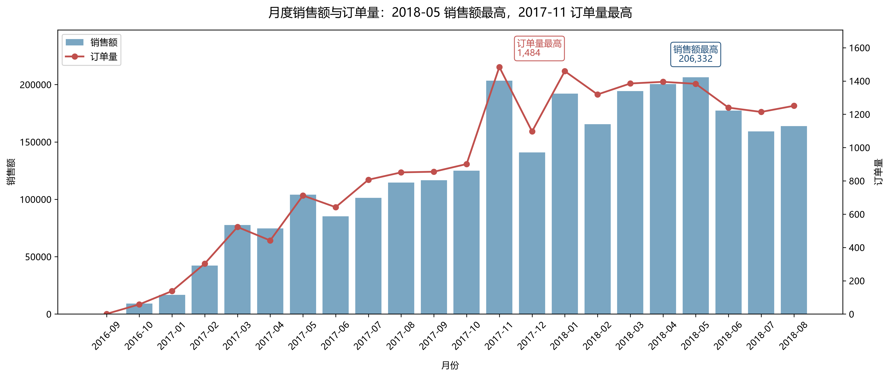
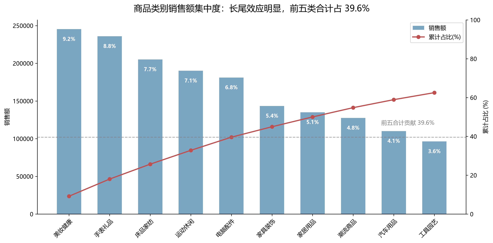
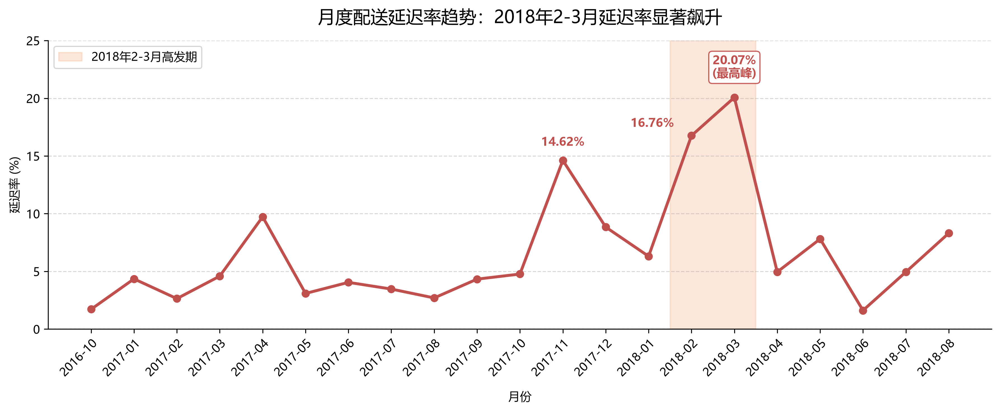
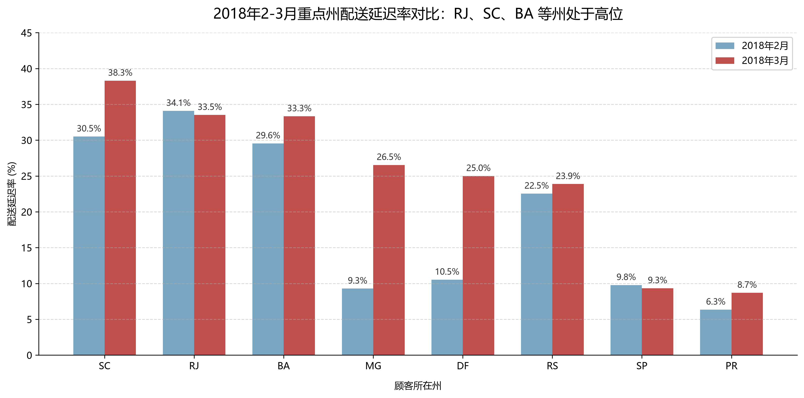
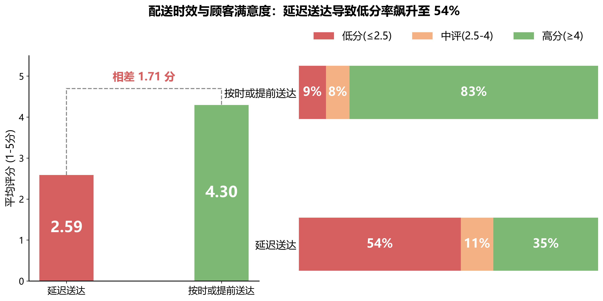

# 🛍️ Olist 巴西电商经营与履约体验分析

[](https://public.tableau.com/app/profile/lishen.li/viz/olist_17936014282330)


> **🔗 在线交互看板**：[点击此处直接体验 Tableau Dashboard](https://public.tableau.com/app/profile/lishen.li/viz/olist_17936014282330)

## 📌 项目背景
Olist 是巴西最大的电子商务平台。本项目基于 Olist 真实的脱敏订单数据（约 2 万笔已交付订单），使用 **SQL 提数清洗、Python 图表定制、Tableau 搭建交互看板**，完整走通了“数据清洗 → 业务分析 → 可视化呈现”的流程。

作为运营导向的分析项目，本次分析重点拆解了**商品结构、履约时效与顾客满意度**，旨在找出影响平台 GMV 增长与口碑的关键节点，并提出优化建议。

---

## 🔑 核心业务发现 (Key Insights)

1. **商品集中度与长尾效应**：全站共 70+ 品类，但美妆健康、手表礼品等前 5 大品类贡献了 **39.6%** 的销售额。整体结构健康，长尾品类众多，具备较大的精细化运营空间。
2. **履约时空双重痛点**：平台整体物流延迟率为 7.85%，但在 **2018 年 3 月延迟率飙升至 20.07%**。区域上，RJ（里约）、SC 等州在 2018 年 2-3 月延迟率均超 30%，存在严重区域运力瓶颈。
3. **物流时效直接决定口碑**：交叉分析发现，延迟送达订单的平均评分仅为 **2.59 分**（低分率高达 54%）；而按时/提前送达订单的平均评分高达 **4.30 分**（低分率仅 9%）。证实了改善履约体验是降低客诉、提升复购率的核心。

---

## 📊 可视化成果展示

### 1. 经营大盘与商品结构
通过时间趋势与帕累托图，定位核心营收月份，并锁定贡献最大的头部品类。

<div align="center">
  <b>月度销售与订单量双轴图 (Python)</b><br><br>
  
  <br><br>
  <b>商品类别集中度帕累托图 (Python)</b><br><br>
  
</div>

<br>

### 2. 履约表现与区域差异
精准锁定高延迟月份，以及存在配送异常的州，为物流部门优化承运商提供数据支撑。

<div align="center">
  <b>月度配送延迟率趋势 (Python)</b><br><br>
  
  <br><br>
  <b>区域配送延迟对比 (Python)</b><br><br>
  
</div>

<br>

### 3. 核心洞察：履约体验与评分的强关联
结合 Python 双轴拼接图与 Tableau 看板，直观呈现物流延迟对用户差评率的巨大影响。

<div align="center">
  <b>配送时效与评分对比 (Python)</b><br><br>
  
</div>

---

## 🛠️ 分析工作流

- **数据清洗与指标计算 (MySQL)**：关联 `orders`、`order_items`、`customers`、`order_reviews` 等表。处理空值与异常值，统一定义：销售额按 `order_items.price` 计算（不含运费），订单量按 `order_id` 去重统计。
- **数据可视化 (Python)**：使用 `Pandas` 进行聚合，使用 `Matplotlib` 定制化绘制 7 张高信息密度的图表（处理了中文字体、双轴图、百分比堆叠、辅助高亮等）。
- **交互看板搭建 (Tableau)**：将结果集导入 Tableau，搭建全局 Dashboard。实现地图、树状图与折线图的联动过滤，支持业务按时间、州代码直接下钻查看数据。

---

## 📁 项目目录结构

```text
olist-ecommerce-analytics/
├── data/
│   └── processed/            # SQL 查询导出的聚合结果集
├── sql/                      # 核心业务查询脚本
│   ├── 01_quality_check.sql  # 数据质量与空值检查
│   ├── 02_sales_analysis.sql # 销售额、品类、趋势聚合
│   └── 03_delivery_analysis.sql # 延迟率、区域、评分交叉分析
├── python/                   # Matplotlib 可视化脚本
├── images/                   # README 中展示的图表截图
├── tableau/                  # 仪表盘打包文件
└── README.md
